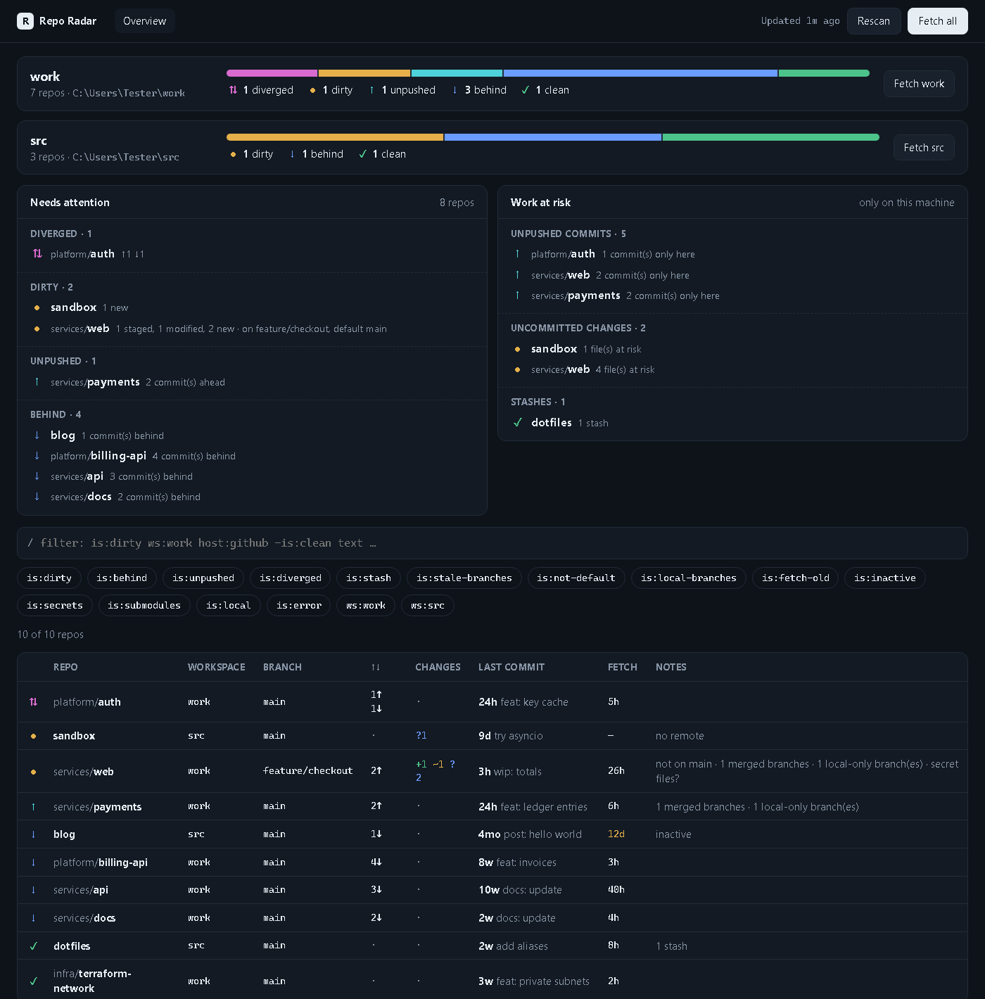
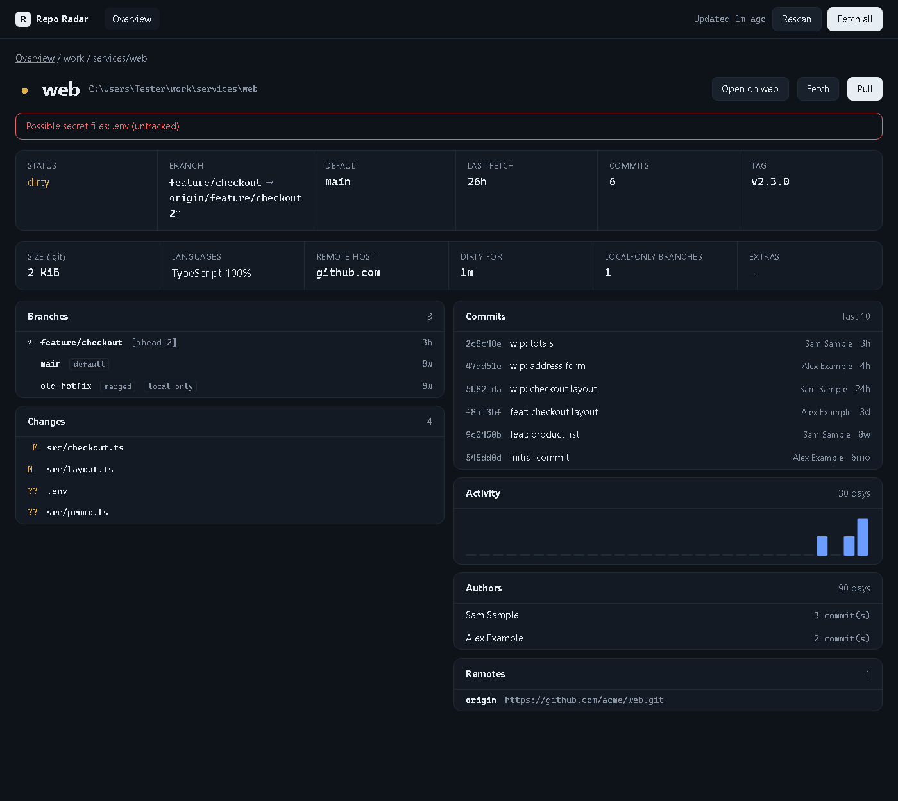

# Repo Radar

See the state of all your local Git repos at a glance, in the browser. A single Python file, standard library only, nothing to install.



*The screenshots show made-up demo repos.*

Repo Radar scans the folders you give it for Git repos and shows where something is still open: uncommitted changes, unpushed commits, repos that are behind their remote, forgotten stashes. The HTML is generated in memory and served by a local server (`127.0.0.1`). No file is written.

## Usage

Requirements: Python 3 (tested with 3.14) and `git` on your `PATH`.

```
python reporadar.py ~/code ~/work
```

Each folder you pass is a workspace and gets its own card. Without arguments, the current directory is scanned. Press Ctrl+C to quit.

| Option | Meaning |
| --- | --- |
| `--depth N` | search depth below the folders (default: 3) |
| `--fetch` | run `git fetch` for all repos on startup |
| `--quiet` | do not print the `git` commands to the console |
| `--no-open` | do not open the browser automatically |
| `--port N` | use a fixed port (default: a free one is picked) |

## What it shows

**Overview**
- One colored bar per workspace with the states `diverged`, `dirty`, `unpushed`, `behind`, `local` and `clean`.
- *Needs attention*: repos grouped by state.
- *Work at risk*: commits that exist only on this machine (all branches), uncommitted changes and stashes.
- A sortable table with branch, ahead/behind, changes, last commit, age of the last fetch and notes (rebase/merge in progress, detached HEAD, not on the default branch, local-only branches, merged branches, "dirty for", possible secret files, out-of-sync submodules, inactive repos).

**Repo page**
- Status, branch with upstream, default branch, last fetch, number of commits, latest tag.
- Size of `.git`, languages, remote host, "dirty for", hooks, LFS, worktrees.
- Branches, changed files, stashes, the last 10 commits, activity over the last 30 days, authors over the last 90 days, submodules, remotes.
- Fetch and pull (`git pull --ff-only`) per repo, and a link to the remote on the web.



## Filters

The filter bar (press `/`) combines several terms. A leading `-` negates a term.

```
is:dirty ws:work -is:clean
host:github is:behind
auth
```

`is:` filters: `dirty`, `behind`, `unpushed`, `diverged`, `conflict`, `clean`, `local`, `error`, `stash`, `stale-branches`, `not-default`, `local-branches`, `fetch-old`, `inactive`, `secrets`, `submodules`, `operation`.
Others: `ws:<workspace>`, `host:<remote-host>`. Free text searches name, path, branch and the last commit message.

## Notes

- All data comes from the local `git`; no forge APIs (GitHub, GitLab) are queried. That means no pull requests and no CI status.
- The *behind* numbers are only as current as the last fetch. The *Fetch* column shows how old that is. It turns yellow for fetches older than 7 days, or for repos that were never fetched.
- Fetch and pull change things. The server listens on `127.0.0.1` only, checks the Host header, and accepts actions only with a random token that the page sends itself. Pull is fast-forward only and never merges or rebases.
- Every `git` command that is run is printed to the console (`$ git …`), including failing ones (`! exit 128: …`). Some optional lookups fail by design, e.g. `describe` in a repo without tags. Use `--quiet` to turn this off.
- A repo counts as *inactive* if its last commit is older than 90 days.
- "Dirty for" is the modification time of the oldest changed file, not the time of the first change.
